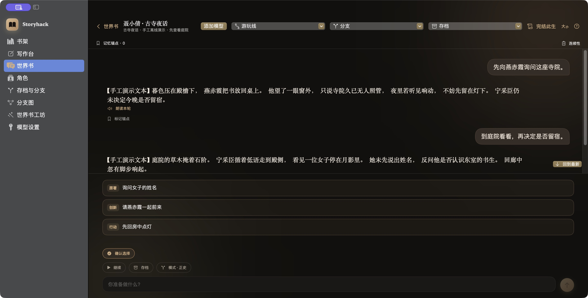
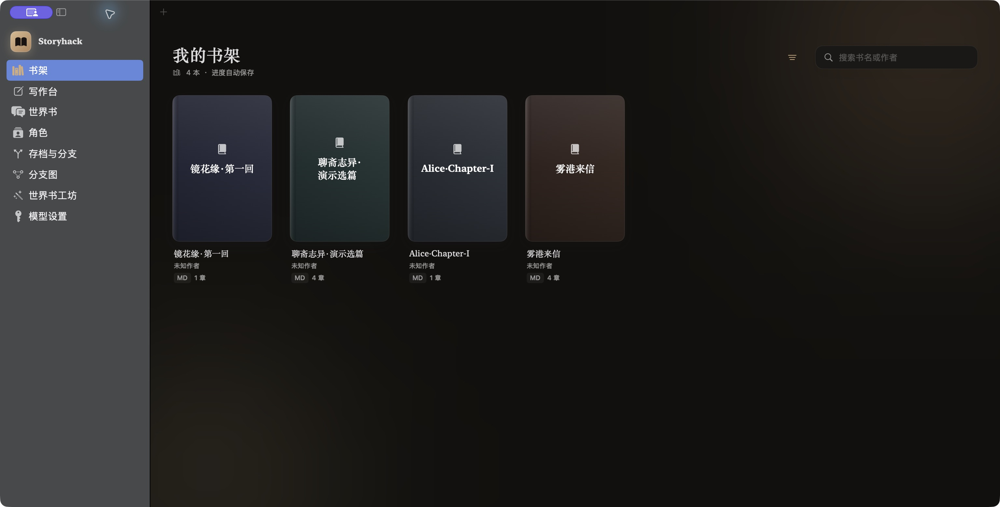
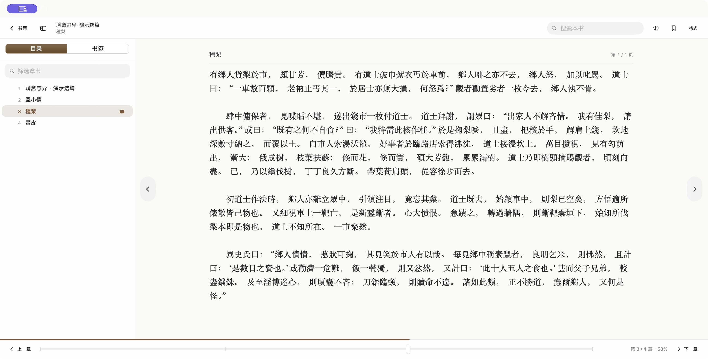
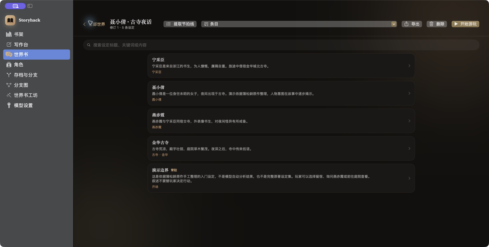
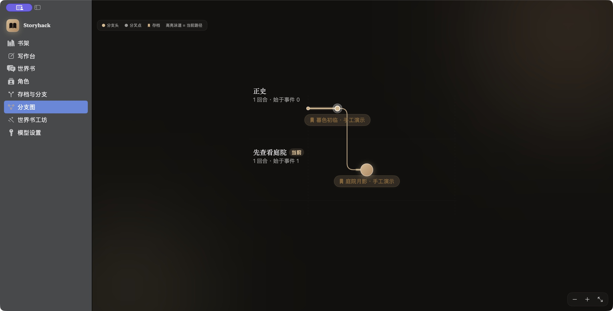

# Storyhack 社区版 · 世界书


**读自己的小说，整理它的世界，走进故事，再试一次不同的选择。**

Storyhack 是 Apple 设备上的本地小说阅读、世界设定管理与互动叙事工具。导入 TXT、Markdown 或 EPUB，整理人物、地点和规则，再接入自选模型展开故事；在关键节点保存进度，建立分支，探索另一种走向。Mac 还提供改编与写作工作区。

这是独立维护的开源社区版，当前为 **0.1.0 开发者预览**。项目代码采用 MIT 许可，没有内购，也没有世界书数量限制。阅读与编辑设定可离线使用；AI 功能使用你配置的模型服务。



*真实社区版 Mac 界面，使用《聂小倩》的手工离线演示数据。图中叙事与选项用于展示操作方式，未调用真实模型，不代表模型生成质量。*

[快速开始](#在-mac-上开始) · [示例与体验步骤](#用一个故事开始) · [当前限制](docs/LIMITATIONS.md) · [参与贡献](CONTRIBUTING.md)

## 从阅读到故事分支

<details>
<summary>1. 导入小说，在本地阅读原文</summary>

书架集中管理导入的小说；阅读器提供章节目录、搜索、书签与阅读进度。随附短篇和章节样例，可先完成一次无需模型的阅读体验。





TXT / Markdown 当前不会自动提取作者，书架会显示“未知作者”；示例作者已注明在正文与来源说明中。

</details>

<details>
<summary>2. 整理人物、地点和规则，建立可编辑的世界书</summary>

世界书保存故事设定，可以手工编辑、导入或导出 Lorebook，也可以用工坊分析小说。下面的宁采臣、聂小倩、燕赤霞和古寺条目来自随附的手工入门设定。



</details>

<details>
<summary>3. 保存关键节点，建立分支，探索另一种选择</summary>

游玩过程中可以存档，并从已有节点建立分支。分支图显示故事路径与存档位置；截图演示了“先查看庭院”这条分支。



图中的回合与存档为人工准备的离线样例。导入随附 Lorebook 只会添加设定，不会自动获得这些回合或存档。实际继续叙事需要先配置模型。

</details>

[截图来源与验证范围](docs/SCREENSHOTS.md) · iPhone 截图尚未提供，平台能力见下表。

## 能做什么

| 功能 | macOS | iOS |
| --- | --- | --- |
| 导入与阅读 TXT、Markdown、EPUB | ✓ | ✓ |
| 新建、编辑、导入与导出世界书 / Lorebook | ✓ | ✓ |
| 管理角色、互动游玩、存档与故事分支 | ✓ | ✓ |
| 用模型分析小说并生成世界书的工坊 | ✓ | ✓，前台运行 |
| 改编、写作工作区及任务命令行 | ✓ | 界面暂未开放 |
| OpenAI-compatible 自选模型配置 | ✓ | ✓ |

阅读与编辑设定不需要模型密钥。互动叙事、工坊分析和 AI 写作会向你配置的模型服务发送相关内容，并可能产生费用。扫描版 EPUB、PDF 和 OCR 暂不支持。远程浏览器访问未包含在社区版中。详见 [当前限制](docs/LIMITATIONS.md) 与 [隐私说明](docs/PRIVACY.md)。

## 用一个故事开始

以《聂小倩》为例，先读原文，再进入故事：

1. 在书架导入 [聊斋演示选篇](Examples/PublicDomain/聊斋志异·演示选篇.md)，在目录选择《聶小倩》；《種梨》适合先试短篇阅读。
2. 在这本书的操作菜单中选择「导入并关联世界书…」，导入 [聂小倩入门设定](Examples/聂小倩.lorebook)。进入「世界书」查看、修改人物与地点；这些步骤无需模型。
3. 如需互动，在「模型设置」添加服务地址、模型 ID 和自己的 API Key，再进入世界书选择「开始游玩」。可以从“先向燕赤霞询问这座寺院”开始，模型回应会随服务与设置变化。
4. 在关键节点「存档」，通过「分支」尝试不同选择，再到「分支图」查看路径。重新进入游玩线后才能查看它的分支图。

入门设定是手工整理的少量条目，用于学习操作，不是完整原著设定集。也可以使用 [原创示例《雾港来信》](Examples/雾港来信.md) 和 [配套世界书](Examples/雾港来信.lorebook)。

| 阅读样例 | 内容 | 适合体验 |
| --- | --- | --- |
| [聊斋志异 · 演示选篇](Examples/PublicDomain/聊斋志异·演示选篇.md) | 《聶小倩》《種梨》《畫皮》古典中文原文 | 短篇阅读、人物设定与故事分支 |
| [镜花缘 · 第一回](Examples/PublicDomain/镜花缘·第一回.md) | 李汝珍原作第一回 | 古典小说阅读、世界设定整理 |
| [Alice · Chapter I](Examples/PublicDomain/Alice·Chapter-I.md) | Lewis Carroll 原作第一章，英文 | 英文阅读与跨语言体验 |

样例均已在社区版完成本地导入。只随附短篇或一个章节，便于初次体验；全文链接、作者、文字整理记录与权利说明见 [公版示例来源](Examples/PublicDomain/README.md)。

## 在 Mac 上开始

需要 macOS 14 或更新版本，以及包含 Swift 6 的 Xcode。首次构建需要联网下载 ZIPFoundation；本项目没有模型服务的默认账号。

```sh
git clone https://github.com/Doubixilin/storyhack-open-source.git
cd storyhack-open-source
./scripts/build-macos-app.sh debug
open .build/StoryhackCommunity.app
```

首次打开后，可按上面的 [示例步骤](#用一个故事开始) 导入小说与世界书。仓库没有模型服务的默认账号，也不会为阅读步骤调用模型。

社区版使用独立的 `StoryhackCommunity` 数据目录、应用标识和 Keychain 服务，不会自动读取原版数据或密钥。迁移设定请使用导出 / 导入；请先备份自己的作品与存档。

## iOS 源码构建

用 Xcode 打开 `Worldbook.xcworkspace`，选择 `WorldbookIOS`。模拟器构建不需要开发者签名；安装到真机时选择自己的开发团队。仓库不包含作者的签名配置。最低 iOS 17，当前主要面向 iPhone。

```sh
xcodebuild -workspace Worldbook.xcworkspace -scheme WorldbookIOS \
  -destination 'generic/platform=iOS Simulator' \
  -derivedDataPath .build/ios CODE_SIGNING_ALLOWED=NO build
```

## 验证与参与

```sh
swift test
python3 scripts/verify_task_cli.py
python3 scripts/public-preflight.py
./scripts/verify-macos-bundle.sh
```

默认测试使用本地夹具与模拟模型。真实模型测试需要显式环境开关与密钥；没有运行真实模型测试时，会显示为跳过。[验证记录](docs/VALIDATION.md) 区分自动测试、构建、资源验证与尚未完成的设备验收。

- [命令行任务说明](docs/CLI任务使用说明.md)
- [结构与维护边界](docs/ARCHITECTURE.md)
- [贡献指南](CONTRIBUTING.md) · [安全问题](SECURITY.md) · [更新记录](CHANGELOG.md)

## 许可与素材

项目代码、项目文档、项目图标及随附的原创 / 合成示例按 [MIT](LICENSE) 提供；依赖保留各自许可，见 [第三方声明](THIRD_PARTY_NOTICES.md)。公版小说原文的权利状态单独说明，不由本项目重新授予 MIT 许可，见 [示例来源](Examples/PublicDomain/README.md)。[素材说明](Materials/README.md) 解释了内置生成素材与测试夹具的用途。用户自行导入的小说、图片与模型输出不因本项目开源而获得再分发许可。

目前提供源码，未发布经过 Developer ID 签名、公证的 Mac 安装包，也未发布 App Store 版本。
